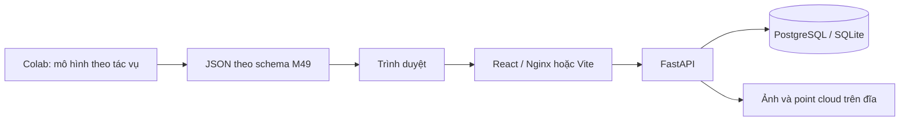

# Quy ước hệ thống M49

Tài liệu chung về kiến trúc, dữ liệu và chấm điểm. Hướng dẫn thao tác hiện tại ở [GUIDED_WORKFLOW](GUIDED_WORKFLOW.md).

- [Kiến trúc và lưu trữ](#architecture)
- [Hợp đồng dữ liệu, hình học và API](#data-contract)
- [Công thức đánh giá](#scoring)

Giao diện chỉ yêu cầu chọn tác vụ test và tên người thực hiện. Dự án/Experiment được tạo ngầm cho mỗi lượt; không có bước chọn hoặc tạo dự án thủ công. Phần công thức phân biệt tính năng đang có và chỉ số tham chiếu chưa triển khai.

## Kiến trúc

Một dự án chỉ có một tác vụ. Luồng test tự tạo dự án riêng cho mỗi lượt; điều này tránh gộp điểm 2D/mask/3D không tương đương.

- `Project`: tên, task, danh sách lớp.
- `Asset`: tên gốc duy nhất trong dự án, đường dẫn lưu UUID, kích thước ảnh hoặc point cloud.
- `LabelSet`: một bản chụp nhãn bất biến theo API hiện tại; nguồn `ground_truth`, `ai`, `manual`, `assisted`.
- `assisted.parent_id`: bắt buộc trỏ đến một LabelSet nguồn AI của cùng dự án.
- `payload`: bundle có thể gồm một hoặc nhiều mẫu; một bản mới không ghi đè bản cũ.

- `Experiment`: khóa ID ground truth, danh sách asset và ngưỡng IoU. Không có endpoint thay đổi cấu hình sau tạo.
- `Assignment`: một người, một mẫu và một chế độ trong thử nghiệm; draft_id và final_id trỏ vào snapshot LabelSet. Có unique constraint theo experiment/asset/annotator/mode.
- `AnnotationEvent`: save/resume/pause/finalize, revision và timestamp server. Chưa ghi từng thao tác hình học.
- Ghi draft/chốt/timer dùng compare-and-swap revision trong cùng giao dịch; yêu cầu cũ bị từ chối 409. Draft tạo snapshot mới, không ghi đè AI.
- Endpoint editor chỉ trả asset, assignment và objects từ draft/final/AI parent; không trả ground truth payload.
- Evaluator chấm bản người đã chốt và từng AI run theo mẫu đã khóa; phân biệt kết quả thiếu với nhãn rỗng. CSV có GT ID, ngưỡng, label-set ID và missing policy.

Frontend dùng React và SVG cho box/polygon, Canvas 2D để chiếu point cloud và cuboid LiDAR; không thêm dependency. History reducer dùng chung ba tác vụ. Draft autosave có debounce 900 ms; rời lượt bị chặn khi còn thay đổi, đang lưu hoặc timer chạy.

Timer dùng timestamp server và heartbeat, với lease 30 giây. Editor tự pause khi ẩn tab hoặc idle; khi mất kết nối, backend chỉ tính tối đa thời gian lease còn lại. Chi tiết cách đo ở [quy trình demo](DEMO_PROTOCOL.md).

Lưu trữ file và database chưa có giao dịch phân tán. API xóa file khi ghi database thất bại; chưa có tác vụ quét file mồ côi sau crash. Đây là điểm cần hoàn thiện khi triển khai thật.

Ground truth tách theo source và không được nạp vào editor; API chưa xác thực/phân quyền. Cần vai trò reviewer/admin và annotator trước khi thu thập kết quả mù nhiều người.

Khởi tạo database vẫn dùng create_all để tạo các bảng chưa tồn tại, không cập nhật schema bảng cũ. Thay đổi này thêm bảng mà không đổi cột ở Project/Asset/LabelSet. Alembic và kiểm tra nâng cấp trên bản sao dữ liệu còn trong ROADMAP; không xóa database đang có dữ liệu để thay migration.

### Kết nối Colab cá nhân qua Google API (13/10/2026)

`colab_google.py` quản lý OAuth Desktop với PKCE/state, tải dữ liệu và tạo notebook theo từng job. Quyền M49 là `drive.file`; token chỉ lưu local trong storage. Notebook dùng xác thực Google riêng của Colab, không chứa token của M49. Xem [cấu hình và vận hành](GUIDED_WORKFLOW.md#kết-nối-google-một-lần-trên-máy-local).

`POST /api/guided/{id}/ai/google` chỉ nhận sau đủ 10 Manual, khóa mẫu/model vào request và xếp lượt tải lên. Worker lưu ID Drive trước khi upload để retry không trùng, chỉ xuất URL Colab sau khi đã chuẩn bị đủ ảnh/model/notebook. Trạng thái `awaiting_colab` nghĩa là chờ người dùng chạy notebook hoặc chờ kết quả, không khẳng định runtime đang chạy. Kết quả dùng tệp được ứng dụng tạo sẵn, marker ghi cuối; backend kiểm tra job/checksum/schema/mẫu trước khi nhập một lần. Lượt gắn với tài khoản gửi ban đầu, tài khoản khác không được tiếp tục tải dữ liệu của lượt đó.

Không đổi schema database. `google.json` nằm cạnh bản staging của mỗi job, chứa ID Drive và tài khoản (không chứa token); backend dùng lại worker đồng bộ hiện có. Docker mount `colab/` chỉ đọc để tạo notebook. Chỉ hỗ trợ một worker local, OAuth callback cổng 8000 trên cùng máy với trình duyệt.

## Hợp đồng dữ liệu M49 v1.0

Schema thực thi ở `backend/app/schemas.py`; `label-bundle.schema.json` được sinh từ Pydantic. Gói JSON nội bộ **không phải** định dạng nhãn BDD100K/KITTI gốc. Cần adapter trước khi import dữ liệu thật.

Mỗi bundle có:

- `schema_version`: `1.0`.
- `task`: `detection_2d`, `instance_segmentation` hoặc `detection_3d`.
- `name`: tên bộ nhãn/lần chạy.
- `annotator`: bắt buộc cho manual/assisted.
- `parent_id`: ID lần chạy AI, chỉ dùng cho assisted.
- `run`: model, checkpoint, gpu, library_version, inference_seconds, training_seconds, compute_cost_vnd; giá trị chưa đo để null.
- `samples`: tên tệp khớp chính xác tài nguyên đã upload, objects, active_seconds (null nếu chưa đo).

Một đối tượng có id duy nhất trong mẫu, category trong danh sách lớp dự án, geometry và confidence. AI bắt buộc confidence [0,1]; nhãn người có thể để null.

### Hình học

- 2D: `{"kind":"bbox2d","xyxy":[x1,y1,x2,y2]}`. Pixel theo ảnh gốc, gốc góc trên trái, x sang phải, y xuống dưới. x2>x1, y2>y1. Chuyển khung sau letterbox/resize về ảnh gốc trước khi xuất.
- Instance segmentation: `{"kind":"polygon","points":[[x,y],...]}`. Từ 3 đến 1.000 đỉnh, pixel ảnh gốc. Từ chối đỉnh trùng, tự giao/tự chạm, cạnh chồng và diện tích 0; không lặp đỉnh đầu ở cuối. Chưa hỗ trợ holes, multipart hoặc RLE. Không coi một polygon là biểu diễn đầy đủ mọi mask thực tế.
- 3D: `{"kind":"cuboid3d","center":[x,y,z],"size_lwh":[l,w,h],"yaw":0,"frame":"lidar"}`. Mét, tâm hình học hộp, hệ LiDAR x tiến, y trái, z lên; yaw radian quanh +z. KITTI camera labels dùng quy ước khác: phải chuyển tọa độ và tâm hộp bằng calibration trước khi nhập. Adapter KITTI trong `backend/app/adapters/datasets.py` thực hiện chuyển đổi này khi nhập dữ liệu.

3D gắn nhãn vào asset pointcloud. Ảnh camera có thể upload nhưng quan hệ ảnh–pointcloud–calibration chưa triển khai.

### Nhãn sau sửa AI

Giữ nguyên object id khi sửa tọa độ/lớp; tạo id mới khi thêm. Về sau dùng id và event log để tính edits, không tự suy diễn toàn bộ lịch sử chỉ từ hai snapshot. Backend hiện chỉ kiểm tra parent cùng dự án/source AI, chưa xác minh từng thay đổi có đúng nguồn gốc hay không.

### Nhãn trống

`objects: []` là mẫu đã được biểu diễn với không đối tượng. Không có sample trong bundle nghĩa là thiếu kết quả cho mẫu đó. Bộ chấm giữ mẫu thiếu ở báo cáo completion, loại khỏi metric với missing_policy công khai; không tự chuyển thành nhãn rỗng.

### Bổ sung ngày 2026-10-09

Cấu trúc bundle vẫn là v1.0; bổ sung ràng buộc polygon như trên. Experiment/Assignment được lưu riêng, không nhét thêm trường vào bundle.

- POST `/api/projects/{id}/experiments`: name, ground_truth_id, asset_ids, iou_threshold (0 < ngưỡng <= 1). Mỗi asset phải có sample trong ground truth, kể cả objects rỗng.
- POST `/api/experiments/{id}/assignments`: asset_id, annotator, mode manual/assisted, parent_id chỉ với assisted. Parent AI phải có sample tương ứng.
- GET `/api/assignments/{id}/editor`: assignment, asset và objects; không có ground truth payload.
- POST `/api/assignments/{id}/draft`: revision hiện tại và objects. Server tự xác định asset/task/annotator/parent từ assignment, trả revision mới.
- POST `/api/assignments/{id}/finalize`: revision; yêu cầu có draft trước đó. Final trỏ vào draft hiện tại và bất biến qua API này.
- POST `/api/assignments/{id}/events`: revision, kind resume/pause. GET cùng đường dẫn để đọc event log. Thời gian kết thúc phiên ở Assignment là nguồn chuẩn cho báo cáo, còn active_seconds trong bundle là snapshot tại lúc save.
- GET `/api/experiments/{id}/score` và `/results.csv`: metric M49; null hiển thị N/A. Không gọi các kết quả này là COCO/KITTI official.

Segmentation raster hóa ở độ phân giải ảnh gốc bằng quy tắc tâm pixel (x+0.5,y+0.5), even/odd scanline; giao điểm/cạnh dùng khoảng nửa mở để tránh đếm đôi. Mask instance rỗng bị từ chối khi chấm. IoU mask dùng giao/hợp pixel, Dice của cặp ghép = 2*IoU/(1+IoU).

IoU 3D dùng giao hai hình chữ nhật đáy đã xoay yaw, nhân phần giao chiều cao. Không hỗ trợ pitch/roll, không dùng BEV thay cho 3D.

Giới hạn demo ngày 10/10/2026: lưu draft vẫn tối đa 300 đối tượng, nhưng bộ chấm chỉ nhận tối đa 80 đối tượng mỗi phía/mẫu; mask tối đa 4 triệu pixel/ảnh và 32 triệu pixel tổng kích thước mask/mẫu. Mỗi thử nghiệm tối đa 20 mẫu; chấm tối đa 40 Assignment và 3 AI run/dự án. Viewer đọc BIN little-endian x,y,z,intensity và PCD ASCII/binary không nén, chỉ lấy mẫu tối đa 60.000 điểm để hiển thị; vẫn đọc tệp gốc vào bộ nhớ và không thay đổi file đó.

Timer nhận resume/pause/heartbeat qua endpoint events, cùng cơ chế revision. Heartbeat tích lũy thời gian rồi gia hạn lease 30 giây; lease hết hạn không tự chạy lại khi heartbeat đến muộn, cần resume. Response Assignment thêm timer_remaining_seconds. Không tạo event log cho từng heartbeat để giảm số bản ghi. Chi tiết cách đo và giới hạn ở DEMO_PROTOCOL.md.

## M49 — Đặc tả công thức đánh giá cho website Human vs AI Annotation Benchmark Portal

**Phiên bản:** 2.4 — sửa toàn bộ lỗi hiển thị từ bản công thức LaTeX đính kèm  
**Ngày:** 08/10/2026  
**Sản phẩm:** Website M49 để quản lý, đối chiếu, chấm chất lượng và trình bày kết quả gán nhãn **manual**, **AI** và **assisted** cho bounding box 2D, instance segmentation và bounding box 3D.  
**Nguyên tắc trình bày:** Đây là tài liệu các công thức phục vụ tính toán và hiển thị **trên website**, không phải hướng dẫn phát triển một tool độc lập. Chỉ sử dụng Markdown thông thường và ký hiệu toán học Unicode. Không sử dụng cú pháp LaTeX, mã nguồn, mã giả, JSON hoặc hướng dẫn cài đặt.

> **Quy ước đọc công thức:** Dấu **×** là phép nhân; **÷** hoặc **/** là phép chia; **∑** là tổng; **∩** là giao; **∪** là hợp; **|A|** là số phần tử, diện tích hoặc thể tích tùy ngữ cảnh; **≈** là xấp xỉ. **N/A** nghĩa là không xác định hoặc không áp dụng, không được tự chuyển thành 0 hay 1. Dấu phẩy trong số thập phân dùng theo cách viết tiếng Việt (ví dụ: 0,50).

### 1. Mục tiêu và phạm vi đánh giá của website

**M49 là một website**, không phải chương trình dòng lệnh hay phần mềm chấm điểm chạy độc lập. Các công thức trong tài liệu là **quy tắc tính điểm mà website cần áp dụng** khi người dùng chọn bộ dữ liệu và so sánh các bản nhãn. Website phải thể hiện kết quả bằng giao diện trực quan và báo cáo, đồng thời giữ lại thông tin về cấu hình đánh giá.

**Luồng chức năng cần hỗ trợ trên website:** người dùng lựa chọn bộ dữ liệu/ground truth đã khóa, chọn các phiên bản nhãn manual, AI và assisted, chọn ngưỡng đánh giá, sau đó xem kết quả theo ảnh, theo lớp, theo phương pháp và tổng hợp toàn bộ tập. Thời gian, mức chỉnh sửa và chi phí được trình bày riêng, không biến thành một điểm tổng tùy ý. Đây là **yêu cầu chức năng đề xuất**, không khẳng định website hiện đã triển khai đầy đủ.

M49 có **hai nhóm kết quả đánh giá tách biệt**:

1. **Chất lượng bộ nhãn cuối (giao thức M49):** so sánh nhãn thủ công, nhãn AI và nhãn AI sau khi người kiểm tra/sửa. Các chỉ số gồm TP, FP, FN, Precision, Recall, F1, IoU trung bình của những cặp được ghép và tỷ lệ hoàn thành. Nhãn do người gán không cần confidence.
2. **Chất lượng mô hình phát hiện (giao thức benchmark):** COCO-style AP cho bounding box/mask và KITTI AP-R40 cho hộp 3D. Cần confidence của mô hình và tuân thủ quy tắc matching, ignore/crowd, difficulty và xếp hạng của từng bộ đánh giá. **Không được dùng phép ghép của M49 thay cho phép ghép COCO/KITTI.**

Chất lượng hình học, độ đầy đủ của nhãn, thời gian và chi phí là **các trục đánh giá riêng**. Không gộp thành điểm tổng khi chưa chốt trọng số.

#### Ký hiệu cơ bản

| Ký hiệu | Ý nghĩa |
|---|---|
| G | Tập nhãn chuẩn (ground truth) trên một mẫu |
| P | Tập nhãn dự đoán trên cùng mẫu |
| c | Lớp đối tượng |
| τ | Ngưỡng IoU để chấp nhận ghép |
| M | Tập cặp ghép một–một hợp lệ |
| N | Tổng số mẫu được giao |
| n | Số mẫu hoàn thành |
| ∣A∣ | Số phần tử, diện tích hoặc thể tích của A tùy ngữ cảnh |
| A ∩ B | Phần giao giữa A và B |
| A ∪ B | Phần hợp giữa A và B |
| N/A | Không xác định/không áp dụng |

**Điều kiện so sánh:** cùng danh sách lớp, mẫu đánh giá, phiên bản ground truth đã khóa, quy tắc che khuất, cắt biên, ignore và định nghĩa hoàn thành. Nên chia dữ liệu theo cảnh hoặc video để hạn chế rò rỉ giữa các tập.

**Yêu cầu hiển thị trên website:** khi một chỉ số không xác định, giao diện hiện **N/A** cùng lý do; không tự thay bằng 0 hoặc 100%. Website phải hiển thị ngưỡng IoU, loại hình học (2D/mask/3D), phạm vi mẫu, số cặp ghép và số lượng mẫu thiếu bên cạnh kết quả tương ứng.

### 2. IoU của bounding box 2D

Hai hộp **A = (aₓ₁, aᵧ₁, aₓ₂, aᵧ₂)** và **B = (bₓ₁, bᵧ₁, bₓ₂, bᵧ₂)** dùng tọa độ liên tục trên ảnh gốc, với x₁ < x₂ và y₁ < y₂.

Chiều rộng và chiều cao phần giao:

> **wᵢ = max(0, min(aₓ₂, bₓ₂) − max(aₓ₁, bₓ₁))**  
> **hᵢ = max(0, min(aᵧ₂, bᵧ₂) − max(aᵧ₁, bᵧ₁))**

Diện tích phần giao và diện tích từng hộp:

> **I = wᵢ × hᵢ**  
> **S(A) = (aₓ₂ − aₓ₁) × (aᵧ₂ − aᵧ₁)**  
> **S(B) = (bₓ₂ − bₓ₁) × (bᵧ₂ − bᵧ₁)**

**Công thức cần áp dụng:**

> **IoU₂D(A, B) = I / [S(A) + S(B) − I]**

**Kiểm tra số học:** A = (0, 0, 10, 10), B = (5, 0, 15, 10). Phần giao có diện tích 50, mỗi hộp có diện tích 100, do đó **IoU = 50 / (100 + 100 − 50) = 1/3 ≈ 0,333333**.

Không cộng 1 vào chiều rộng/chiều cao trong hệ tọa độ liên tục; hình chữ nhật có diện tích không dương là dữ liệu không hợp lệ. [S1–S2]

### 3. Instance segmentation: Mask IoU và Dice

A và B là hai tập pixel foreground của **hai instance** đang được so sánh. Gọi **I = |A ∩ B|** là số pixel phần giao, **U = |A ∪ B|** là số pixel phần hợp.

> **U = |A| + |B| − I**

**Các công thức cần áp dụng:**

> **IoU(mask) = I / U**  
> **Dice = 2 × I / (|A| + |B|)**

Quan hệ giữa hai chỉ số (khi mẫu số hợp lệ):

> **Dice = 2 × IoU(mask) / [1 + IoU(mask)]**

**Kiểm tra số học:** |A| = 100, |B| = 120, I = 80, vì vậy U = 140. Khi đó **IoU(mask) = 80/140 = 4/7 ≈ 0,571429** và **Dice = 160/220 = 8/11 ≈ 0,727273**.

Không thay mask IoU bằng IoU của bounding box. Nếu cả hai mask rỗng thì có phép chia 0/0, không tự cho điểm 1. Mask rỗng của một instance là lỗi dữ liệu; trường hợp ảnh không có instance được xử lý ở cấp tập đối tượng. Cần thống nhất kích thước mask và quy tắc raster hóa. [S1], [S3]

### 4. Bounding box 3D chỉ xoay yaw quanh trục đứng

**Quy ước M49:** mỗi hộp được biểu diễn bởi tâm (cₓ, cᵧ, c_z), chiều dài l, chiều rộng w, chiều cao h và góc yaw θ. Tâm là **tâm hình học**, trục z hướng lên, l/w/h > 0 và đo bằng mét, θ đo bằng radian. Hộp không có pitch hoặc roll.

Bốn đỉnh đáy trong hệ tọa độ cục bộ:

> **(−l/2, −w/2); (l/2, −w/2); (l/2, w/2); (−l/2, w/2)**

Với một đỉnh cục bộ (u, v), tọa độ sau quay yaw và tịnh tiến:

> **x = cₓ + u × cos(θ) − v × sin(θ)**  
> **y = cᵧ + u × sin(θ) + v × cos(θ)**

Gọi **S(giao)** là diện tích giao của hai đa giác đáy xoay. Với hai hộp A và B:

> **zmin(A) = c_z(A) − h(A)/2**  
> **zmax(A) = c_z(A) + h(A)/2**  
> **zmin(B) = c_z(B) − h(B)/2**  
> **zmax(B) = c_z(B) + h(B)/2**

Chiều cao và thể tích phần giao:

> **hᵢ = max(0, min(zmax(A), zmax(B)) − max(zmin(A), zmin(B)))**  
> **V(giao) = S(giao) × hᵢ**  
> **V(A) = l(A) × w(A) × h(A)**  
> **V(B) = l(B) × w(B) × h(B)**

**Hai công thức cần phân biệt:**

> **IoU₃D = V(giao) / [V(A) + V(B) − V(giao)]**  
> **IoU(BEV) = S(giao) / [l(A) × w(A) + l(B) × w(B) − S(giao)]**

**Kiểm tra số học:** hai hộp có cùng tâm và kích thước l = 4, w = 2, h = 2, quay lệch nhau 90°. Diện tích giao đáy là 4, thể tích phần giao là 8, thể tích mỗi hộp là 16. Kết quả **IoU₃D = 8 / (16 + 16 − 8) = 1/3**.

Công thức trên đúng với hộp cùng trục đứng chỉ xoay yaw; nếu có pitch/roll phải tính giao khối đa diện tổng quát. Quy ước tọa độ camera của KITTI khác LiDAR và phải được chuyển đổi chính xác. **BEV IoU không tương đương IoU 3D.** [S5–S7]

#### Sai số hình học 3D bổ sung

Với cặp ghép dự đoán p và ground truth g:

> **e(tâm) = √[(cₓ(p) − cₓ(g))² + (cᵧ(p) − cᵧ(g))² + (c_z(p) − c_z(g))²]**

Sai số tương đối của từng kích thước:

> **e(l) = |l(p) − l(g)| / l(g)**  
> **e(w) = |w(p) − w(g)| / w(g)**  
> **e(h) = |h(p) − h(g)| / h(g)**

Sai số yaw đã xử lý vòng góc:

> **Δθ = θ(p) − θ(g)**  
> **e(yaw) = |atan2(sin(Δθ), cos(Δθ))|**  
> **e(yaw, độ) = e(yaw) × 180 / π**

Sai số góc nằm trong [0, π] radian. Nếu cần phân biệt đầu và đuôi xe, phải báo sai số yaw riêng: hộp hình chữ nhật quay 180° có thể giữ nguyên IoU.

### 5. Ghép một–một nhãn cuối (giao thức riêng M49)

Ở **mỗi ảnh và mỗi lớp**, đặt Q(i, j) là IoU giữa dự đoán i và nhãn chuẩn j. Chỉ cặp có **Q(i, j) ≥ τ** mới hợp lệ.

> **E(τ) = tập tất cả cặp (i, j) thỏa Q(i, j) ≥ τ**

Mỗi nhãn dự đoán và nhãn chuẩn được xuất hiện tối đa một lần trong tập ghép M. Chọn **M⋆** theo mục tiêu tối ưu hai cấp:

> **Ưu tiên 1:** tối đa hóa số cặp hợp lệ **|M|**.  
> **Ưu tiên 2:** trong những nghiệm có số cặp tối đa, tối đa hóa **∑ Q(i, j)** trên mọi cặp (i, j) thuộc M.

Có thể viết gọn mục tiêu:

> **M⋆ = arg max theo thứ tự ưu tiên (số cặp hợp lệ, tổng IoU)**, với M là tập ghép một–một, mọi cặp thuộc E(τ).

**Phản ví dụ kiểm tra:** với τ = 0,50, ma trận IoU Q được biểu diễn như sau:

| | GT 1 | GT 2 |
|---|---:|---:|
| Dự đoán 1 | 1,00 | 0,50 |
| Dự đoán 2 | 0,50 | 0,49 |

Ghép chéo tạo **2 cặp** đạt ngưỡng; ghép đường chéo chỉ có **1 cặp** đạt ngưỡng. M49 phải chọn ghép chéo, dù tổng IoU của đường chéo trước lọc ngưỡng lớn hơn.

Những nghiệm đồng hạng có thể khác ID cặp nhưng phải giống số cặp tối đa và tổng IoU tối ưu. Phép ghép này **không phải phép ghép chính thức của COCO/KITTI**; dữ liệu có crowd/ignore cần quy tắc riêng. [S4]

### 6. TP, FP, FN, Precision, Recall và F1 của bộ nhãn cuối

Sau khi ghép trên mỗi mẫu và lớp:

> **TP = số cặp ghép hợp lệ = |M⋆|**  
> **FP = số nhãn dự đoán hợp lệ − TP**  
> **FN = số nhãn ground truth cần đánh giá − TP**

**Công thức cần áp dụng:**

> **Precision = TP / (TP + FP)**  
> **Recall = TP / (TP + FN)**  
> **F1 = 2 × TP / (2 × TP + FP + FN)**

**Kiểm tra số học:** GT = 120, prediction = 100, TP = 80, nên FP = 20 và FN = 40. Do đó **Precision = 80%**, **Recall ≈ 66,67%**, **F1 = 160/220 = 8/11 ≈ 72,73%**.

#### Xử lý mẫu số bằng 0 theo M49

| Tình huống | Precision | Recall | F1 |
|---|---:|---:|---:|
| Có GT, không có dự đoán | N/A | 0 | 0 |
| Không có GT, có dự đoán | 0 | N/A | 0 |
| Không có GT, không có dự đoán | N/A | N/A | N/A |
| Mọi mẫu số xác định | Theo công thức | Theo công thức | Theo công thức |

Đối với toàn bộ dataset, **cộng TP, FP và FN trước khi tính tỷ số**, không lấy trung bình F1 theo từng ảnh. Dự đoán sai lớp có thể tạo FP ở lớp dự đoán và FN ở lớp chuẩn.

#### Micro-F1, macro-F1 và trung bình IoU

Tính các tổng theo lớp:

> **TP(tổng) = ∑ TP(c)**  
> **FP(tổng) = ∑ FP(c)**  
> **FN(tổng) = ∑ FN(c)**

**Micro-F1:**

> **F1(micro) = 2 × TP(tổng) / [2 × TP(tổng) + FP(tổng) + FN(tổng)]**

**Macro-F1:** với C′ là tập lớp được đưa vào macro và k = số lớp thuộc C′:

> **F1(macro) = [∑ F1(c), với c thuộc C′] / k**, khi k > 0.

Phải công bố tập C′ trước (khuyến nghị gồm các lớp có GT trong benchmark). Các lớp không có GT nhưng có FP vẫn phải hiển thị và đóng góp vào micro.

**IoU trung bình của những cặp ghép:**

> **IoU(trung bình cặp ghép) = [∑ Q(i, j), với (i, j) thuộc M⋆] / |M⋆|**, khi |M⋆| > 0.

Nếu không có cặp ghép, chỉ số này là **N/A**. Đây là chất lượng hình học **có điều kiện trên các cặp được ghép**; phải báo kèm recall và số cặp, không dùng độc lập để xếp hạng.

### 7. COCO-style AP cho bounding box và mask

Với mỗi lớp c và ngưỡng IoU t, xếp dự đoán theo confidence giảm dần. Sau phép ghép và xử lý crowd/ignore **đúng giao thức COCO**, xét k dự đoán đầu tiên:

> **P(k) = TP(k) / [TP(k) + FP(k)]**  
> **R(k) = TP(k) / N(GT, c)**

Trong đó N(GT, c) là số nhãn chuẩn hợp lệ của lớp c, đã áp dụng chính sách ignore.

**Precision nội suy ở recall r:**

> **p(nội suy; r, c, t) = max P(k) trên các k thỏa R(k) ≥ r.**

Nếu không có k phù hợp và lớp có GT hợp lệ, giá trị nội suy là 0.

**COCO dùng 101 mốc recall:** 0; 0,01; 0,02; …; 1,00.

> **AP(c, t) = [tổng p(nội suy; r, c, t) tại 101 mốc recall] / 101**

Các chỉ số báo cáo:

> **AP50 = trung bình AP(c, 0,50) trên các lớp hợp lệ.**  
> **AP75 = trung bình AP(c, 0,75) trên các lớp hợp lệ.**  
> **AP50:95 = trung bình AP(c, t) trên các lớp hợp lệ và 10 ngưỡng t = 0,50; 0,55; …; 0,95.**

**Đối chiếu giao thức:** COCOeval mặc định có 10 ngưỡng IoU từ 0,50 đến 0,95 (bước 0,05), 101 mốc recall và các cấu hình riêng cho area/max detections; thường dùng giới hạn tối đa 100 detection để báo AP chuẩn. **Những công thức ở trên không đủ để tái tạo chính xác COCO AP** nếu bỏ qua thứ tự score, score trùng, crowd, ignore, giới hạn số detection và các miền diện tích. [S1–S2]

**Kiểm tra khác biệt AP và F1:** Một ground truth có hai dự đoán trùng khung, TP có confidence cao hơn FP. AP có thể đạt 1, nhưng bộ nhãn cuối có TP = 1, FP = 1, FN = 0 nên **F1 = 2/3**. Không dùng AP để thay F1 của bộ nhãn cuối; không tạo confidence giả cho nhãn người.

### 8. KITTI 3D AP-R40

KITTI đánh giá các lớp Car, Pedestrian và Cyclist ở ba mức **Easy / Moderate / Hard**. Ngưỡng overlap 3D được công bố: **Car = 0,70; Pedestrian = 0,50; Cyclist = 0,50**. Không gắn nhãn “KITTI official” cho ngưỡng tự chọn đối với Bus/Truck. [S7–S8]

**Công thức mô tả nguyên lý:**

> **AP(R40) = [p(1/40) + p(2/40) + … + p(40/40)] / 40**

Trong đó p(r) là precision nội suy theo cách lấy mẫu và xử lý score của evaluator KITTI tương ứng.

KITTI dùng 40 vị trí recall **không tính mốc 0**, thay cho cách AP11 cũ. Tuy nhiên score threshold, matching, difficulty, ignored classes, nội suy và phép so sánh overlap phải đúng evaluator; **không thể lấy COCO AP rồi chỉ thay 101 bằng 40**. Công thức trên là mô tả khái niệm, không thay thế triển khai KITTI chính thức. [S7–S8]

### 9. Tỷ lệ hoàn thành và dữ liệu thiếu

Với N mẫu được giao, n mẫu đã hoàn thành:

> **Completion Rate = n / N**, với N > 0.

Mẫu **đã hoàn thành và không có đối tượng** khác với mẫu **chưa hoàn thành hoặc lỗi xử lý**. Không bỏ âm thầm mẫu khó khỏi mẫu số. Cần công bố tỷ lệ bao phủ, số lỗi và chính sách xử lý kết quả thiếu; chỉ coi missing là dự đoán rỗng khi giao thức đã quy định từ trước.

### 10. Đo thời gian

Với các khoảng làm việc chủ động hợp lệ, không chồng lấn, khoảng thứ k bắt đầu tại s(k), kết thúc tại e(k):

> **T(chủ động) = ∑ [e(k) − s(k)]**

Nếu khoảng thời gian chồng lấn, phải tính **độ dài hợp của các khoảng**, không được cộng trùng. Phân biệt thời gian chủ động với thời gian từ bắt đầu tới hoàn tất, bao gồm cả chờ/nghỉ.

**Throughput và thời gian phân bổ mỗi mẫu:**

> **Throughput = N(đã xử lý) / T(job)**  
> **Thời gian phân bổ/mẫu = T(job) / N(đã xử lý)**

Thời gian phân bổ mỗi mẫu không nhất thiết là latency của một request. Khi đo AI phải nói rõ phạm vi: tải mô hình, warm-up, tiền xử lý, inference, hậu xử lý, truyền dữ liệu; không gộp huấn luyện vào inference. Chỉ so sánh khi phần cứng, batch size, kích thước đầu vào và phạm vi đo tương đương.

#### Tiết kiệm thời gian nhân công và thời gian tuần tự

Ký hiệu T(manual) là thời gian nhân công gán nhãn thủ công, T(assisted) là thời gian nhân công kiểm tra/sửa nhãn AI, T(AI) là thời gian tạo nhãn AI.

> **Tiết kiệm nhân công = 1 − T(assisted) / T(manual)**

Khi AI tạo nhãn **trước**, sau đó con người sửa **tuần tự**:

> **T(assisted tuần tự) = T(AI) + T(assisted)**  
> **Tiết kiệm thời gian tuần tự = 1 − T(assisted tuần tự) / T(manual)**

Nếu công việc chạy đồng thời, phải đo thời gian hoàn thành thực tế, không cộng thời lượng rồi gọi là wall-clock. Mẫu số 0 cho **N/A**. Tiết kiệm âm nghĩa là chậm hơn, không ép thành 0.

### 11. Mức độ chỉnh sửa nhãn AI

Đối với tập nhãn AI gốc đã khóa, định nghĩa:

- **N(AI):** số nhãn AI ban đầu được đưa cho người kiểm tra.
- **N(edit):** số nhãn AI gốc đã sửa hoặc xóa, mỗi nhãn chỉ đếm một lần.
- **N(keep):** số nhãn AI gốc được giữ nguyên.
- **N(add):** số đối tượng mới được thêm.
- **N(images):** số ảnh hoàn thành.

**Công thức cần áp dụng:**

> **Edit Rate = N(edit) / N(AI)**  
> **Accept Rate = N(keep) / N(AI)**  
> **Additions per Image = N(add) / N(images)**

Nếu mỗi nhãn AI ban đầu chỉ nằm trong một trong hai nhóm **giữ nguyên** hoặc **sửa/xóa**, thì:

> **Accept Rate + Edit Rate = 1**

Nhãn mới thêm không thuộc mẫu số nhãn AI ban đầu. Số thao tác chuột/phím không nhất thiết bằng số nhãn bị thay đổi. Khi mẫu số 0, chỉ số tương ứng là **N/A**.

### 12. Chi phí và điều kiện quyết định

Ký hiệu r(h) là đơn giá nhân công/giờ, r(g) là đơn giá tính toán GPU/giờ, các chi phí khác sử dụng cùng đơn vị tiền.

> **C(manual) = H(manual) × r(h) + C(manual, khác)**  
> **C(AI) = H(GPU) × r(g) + C(API) + C(lưu trữ/truyền dữ liệu)**  
> **C(assisted) = H(assisted) × r(h) + C(AI) + C(assisted, khác)**

**Tỷ lệ tiết kiệm và chi phí mỗi mẫu:**

> **Tiết kiệm chi phí = 1 − C(assisted) / C(manual)**  
> **Chi phí/mẫu hoàn thành = C(tổng) / N(hoàn thành)**

Nếu phân bổ chi phí huấn luyện cho một số mẫu triển khai dự kiến:

> **Chi phí huấn luyện phân bổ/mẫu = C(huấn luyện) / N(triển khai)**

Không cộng trùng tổng chi phí huấn luyện và chính phần phân bổ của nó. Khi mẫu số bằng 0, kết quả là **N/A**. Một phương án chỉ được coi là hiệu quả về chi phí khi đồng thời đạt các ngưỡng chất lượng và hoàn thành đã thống nhất:

> **F1(micro) ≥ F1(tối thiểu)**  
> **Recall ≥ Recall(tối thiểu)**  
> **Completion Rate ≥ Completion Rate(tối thiểu)**

Đây là **ngưỡng quyết định do M49 đặt ra**, không phải ngưỡng chính thức của COCO hoặc KITTI.

### 13. Tổng hợp kết quả và tự kiểm tra

**Trên trang Kết quả của website M49**, bảng so sánh chính phải dùng cùng benchmark, tách theo phương pháp, lớp và loại hình học; báo số mẫu giao/hoàn thành, TP, FP, FN, Precision, Recall, F1(micro), IoU trung bình của cặp ghép và số cặp ghép. Thời gian lao động, thời gian AI, chi phí và tỷ lệ sửa/thêm/xóa phải là **các nhóm thông tin riêng**. COCO/KITTI AP cần hiển thị **ở bảng đánh giá detector riêng**, không trộn vào F1 của nhãn cuối.

**Ở trang xem từng mẫu của website**, cần cho phép đối chiếu nhãn chuẩn với từng nguồn manual/AI/assisted (box 2D, mask hoặc hộp 3D tương ứng); giải thích trạng thái ghép, TP/FP/FN và các trường hợp không được chấm. Đây là mô tả yêu cầu giao diện, không phải một công thức mới.

Nếu tính khoảng tin cậy cho chênh lệch chất lượng hoặc tiết kiệm, đơn vị tái lấy mẫu phải phù hợp tính độc lập của dữ liệu (ảnh hoặc cụm cảnh/video); với thiết kế paired phải giữ nguyên cặp kết quả giữa các phương pháp. Công bố cách lấy mẫu và số lần lặp.

#### Bảng tự kiểm tra số học

| Phép kiểm tra | Kết quả kỳ vọng |
|---|---|
| IoU 2D hai hộp trùng nhau | 1 |
| IoU 2D hai hộp rời nhau hoặc chỉ chạm cạnh | 0 |
| Tính đối xứng của IoU | IoU(A, B) = IoU(B, A) |
| Ví dụ IoU 2D tại mục 2 | 1/3 |
| Ví dụ mask IoU và Dice tại mục 3 | 4/7 và 8/11 |
| Ví dụ IoU 3D xoay 90° tại mục 4 | 1/3 |
| Phản ví dụ matching tại mục 5 | 2 TP, không phải 1 |
| TP = 80; FP = 20; FN = 40 | F1 = 8/11 ≈ 0,727273 |
| GT và prediction đều rỗng | F1 và IoU cặp ghép là N/A, không mặc định 1 |
| Assisted tốn chi phí cao hơn manual | Tỷ lệ tiết kiệm chi phí âm |

### 14. Kết quả đối chiếu và giới hạn xác minh

| Nội dung | Kết luận | Mức bằng chứng |
|---|---|---|
| IoU 2D, Mask IoU, Dice, IoU 3D yaw-only | Công thức phù hợp định nghĩa và các ví dụ số học khi thỏa điều kiện áp dụng | Rà soát toán học và so sánh định nghĩa thư viện hình học |
| Ghép tối đa số cặp rồi tổng IoU | Là mục tiêu nhất quán của giao thức riêng M49, không phải COCO/KITTI matching | Rà soát logic và phản ví dụ |
| TP/FP/FN, Precision, Recall, F1, micro/macro | Phù hợp định nghĩa và quy ước chia cho 0 đã công bố | Kiểm tra đại số và ví dụ số |
| COCO AP50:95, 101 mốc recall | Phù hợp công thức khái niệm, chưa đủ để thay evaluator | Đối chiếu mô tả COCO API; chưa chạy phép so sánh kết quả toàn benchmark |
| KITTI AP-R40 | Phù hợp công thức khái niệm và ngưỡng công bố cho các lớp KITTI được xét | Đối chiếu KITTI/OpenPCDet; chưa chạy đối chiếu toàn evaluator |
| Tiết kiệm lao động, chi phí, tỷ lệ sửa nhãn | Là chỉ số vận hành do M49 định nghĩa | Kiểm tra công thức và mẫu số; chưa đối chiếu log thực tế |

**Giới hạn bằng chứng:** tài liệu gốc nhắc tới 19 nhóm kiểm thử tổng hợp, 1.000 cặp bounding box và 300 ma trận matching nhưng không kèm toàn bộ fixture, log và kết quả chạy để xác minh độc lập. Phiên bản này không tuyên bố đã chạy lại những kiểm thử đó; cũng không chứng minh các màn hình của website M49 đã tích hợp đầy đủ phần tính toán đánh giá, đã chạy KITTI AP-R40 end-to-end hoặc có số liệu chi phí thực.

### 15. Tài liệu đối chiếu định nghĩa và giao thức

- **[S1] COCO API:** https://github.com/cocodataset/cocoapi
- **[S2] COCO evaluation protocol (COCOeval):** https://github.com/cocodataset/cocoapi/blob/master/PythonAPI/pycocotools/cocoeval.py
- **[S3] COCO mask representation / IoU:** https://github.com/cocodataset/cocoapi/blob/master/PythonAPI/pycocotools/mask.py
- **[S4] SciPy — Linear sum assignment:** https://docs.scipy.org/doc/scipy/reference/generated/scipy.optimize.linear_sum_assignment.html
- **[S5] Shapely — Geometry intersection:** https://shapely.readthedocs.io/en/stable/reference/shapely.intersection.html
- **[S6] PyTorch3D — 3D box overlap:** https://pytorch3d.readthedocs.io/en/latest/modules/ops.html
- **[S7] KITTI 3D benchmark:** https://www.cvlibs.net/datasets/kitti/eval_object.php?obj_benchmark=3d
- **[S8] OpenPCDet — KITTI evaluator tham khảo:** https://github.com/open-mmlab/OpenPCDet/tree/master/pcdet/datasets/kitti/kitti_object_eval_python

---

*Tài liệu phục vụ đặc tả công thức và cách trình bày kết quả trên website M49; không chứa mã nguồn, mã giả hay hướng dẫn cài đặt. Ký hiệu Unicode được dùng để tránh lỗi hiển thị lệnh LaTeX trên trình xem Markdown thông thường.*
